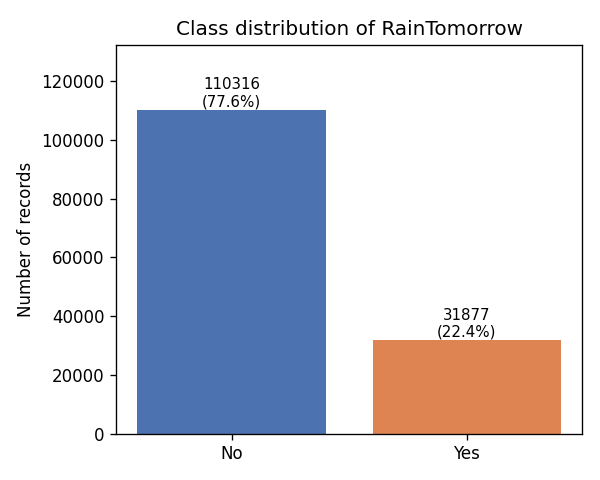
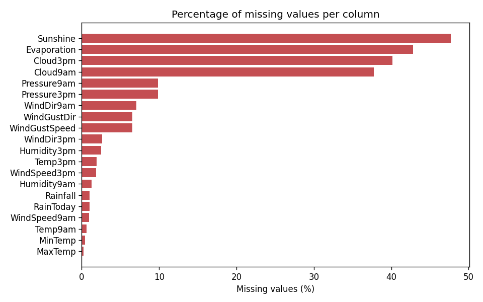
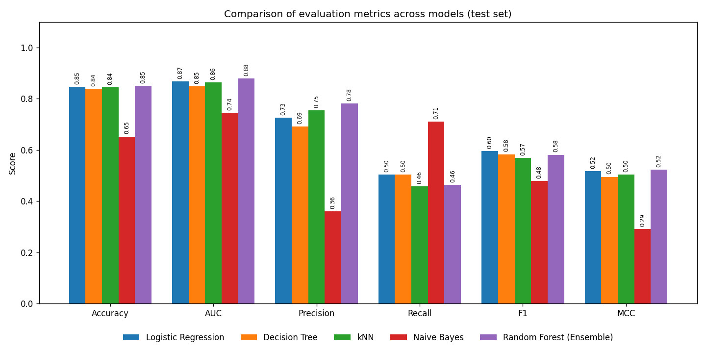
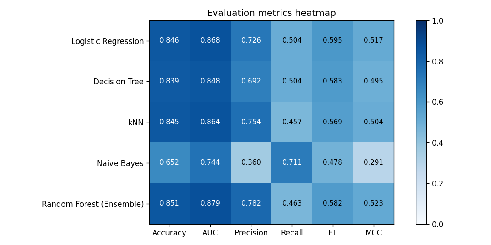
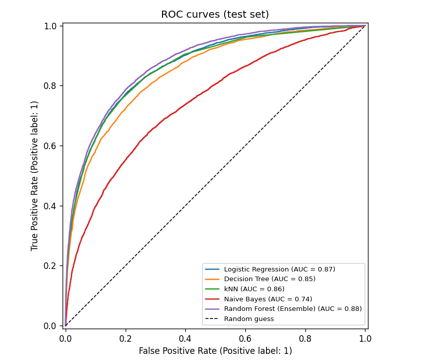
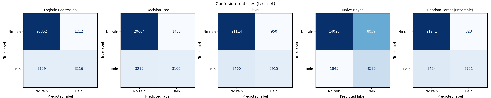

# Rain Prediction in Australia – Comparison of 5 Classification Models
## 1. Problem Statement
The goal is to predict **whether it will rain tomorrow** (`RainTomorrow`: Yes/No) at a given Australian weather station, using today's weather observations. This is a **binary classification** problem.
Five classification models are trained on the same data and compared using Accuracy, AUC, Precision, Recall, F1 and MCC:
Logistic Regression, Decision Tree, k-Nearest Neighbors, Gaussian Naive Bayes, and Random Forest (ensemble).
## 2. Dataset Description
| Item | Details ||---|---|| Name | Rain in Australia (`weatherAUS.csv`) |
| Source | Kaggle – https://www.kaggle.com/datasets/jsphyg/weather-dataset-rattle-package (original data: Australian Bureau of Meteorology) |
| Instances | 145,460 rows (142,193 after removing rows with a missing target) |
| Features | 22 input columns (after converting `Date` to `Month`) |
| Target variable | `RainTomorrow` – Yes (1) / No (0) |
| Problem type | Binary classification |
**Why this dataset was selected**
- It is real-world data (daily observations from 49 weather stations, about 10 years), not synthetic data.
- It meets every assignment requirement: more than 12 features, more than 1,000 rows, a large number of genuine missing values (up to 48% in some columns), and a clearly imbalanced target.
- It mixes numeric and categorical features, so both scaling and encoding are needed.
- The problem is practically useful (rain forecasting for agriculture, water management and events).
**Feature types**
| Type | Features |
|---|---|
| Numeric (16) | MinTemp, MaxTemp, Rainfall, Evaporation, Sunshine, WindGustSpeed, WindSpeed9am, WindSpeed3pm, Humidity9am, Humidity3pm, Pressure9am, Pressure3pm, Cloud9am, Cloud3pm, Temp9am, Temp3pm |
| Categorical (6) | Location (49 stations), WindGustDir, WindDir9am, WindDir3pm (16 compass directions each), RainToday (Yes/No), Month (engineered from Date) |
**Class distribution (imbalance check)**
| RainTomorrow | Count | Share |
|---|---|---|
| No (0) | 110,316 | 77.6% |

| Yes (1) | 31,877 | 22.4% |

The dataset is **imbalanced (roughly 3.5 : 1)**. Because of this, accuracy alone is misleading: a model that always predicts "No" would already get about 77.6% accuracy. MCC, F1 and AUC are therefore used as the main comparison metrics.

**Missing values**
| Column | Missing % |
|---|---|
| Sunshine | 48.0% |

| Evaporation | 43.2% |

| Cloud3pm | 40.8% |

| Cloud9am | 38.4% |

| Pressure9am / Pressure3pm | 10.4% |

| WindDir9am, WindGustDir, WindGustSpeed | ~7% |

| Others | < 3.2% |

## 3. GitHub Repository Link
**Repository:** `https://github.com/2026ct05051-afk/ml-assignment`
### Repository structure

main/

│-- README.md

│-- requirements.txt

│-- test_data.csv                  # 20% stratified hold-out test split (raw, before preprocessing)

│-- weatherAUS.csv                 # original dataset

│-- model/

│   │-- ML_Assignment_2.ipynb      # Jupyter notebook: runs the pipeline step by step with outputs and plots

│   │-- train_models.py            # full pipeline: EDA, preprocessing, training, evaluation, plots

│   └-- saved_models/              # fitted pipelines (*.joblib) for all 5 models

└-- results/

    │-- metrics_comparison.csv

    └-- plots/                     # class distribution, missing values, metric charts, ROC, confusion 

|--labscreenshots                  #screenshots of execution in lab

### Execution instructions

# 1. Clone the repository

git clone https://github.com/2026ct05051-afk/ml-assignment.git

cd main

# 2. Install dependencies

pip install -r requirements.txt

# 3. Train all models, evaluate, and generate test_data.csv, saved models and plots

python model/train_models.py

# Run it in Jupyter Notebook:** start `jupyter notebook` in the project folder, open `model/ML_Assignment_2.ipynb` and choose *Kernel → Restart & Run All*.

## 4. Data Preprocessing

| Step | What was done |

|---|---|

| Missing target | 3,267 rows with no `RainTomorrow` value were removed. A missing label cannot be used for supervised learning, and imputing a label would invent data. |

| Duplicates | Checked with `df.duplicated()`. 0 duplicates found. |

| Feature engineering | `Month` was extracted from `Date` to capture seasonality. `Date` itself was dropped because it is unique per row. |

| Missing numeric values | Median imputation (`SimpleImputer(strategy="median")`). The median is robust to outliers such as extreme rainfall. |

| Missing categorical values | Most-frequent imputation (`SimpleImputer(strategy="most_frequent")`) |

| Encoding | One-hot encoding of categorical features (`OneHotEncoder(handle_unknown="ignore")`) |

| Scaling | `StandardScaler` for the distance- and gradient-based models (Logistic Regression, kNN, Naive Bayes). No scaling for the tree-based models (Decision Tree, Random Forest), because trees split on thresholds and are not affected by feature scale. |

| Train-test split | 80:20, **stratified** on the target (both sets keep the 77.6/22.4 ratio), fixed `random_state = 27` |

| Data leakage prevention | All imputers, encoders and scalers are inside a scikit-learn `Pipeline` / `ColumnTransformer`, so they are **fitted only on the training data** and only applied to the test data. |

Train set: 113,754 rows. Test set: 28,439 rows.

## 5. Models Used and Configuration

| Model | Configuration |

|---|---|

| Logistic Regression | `max_iter=2000, C=1.0` (L2 regularisation) |

| Decision Tree | `max_depth=10, min_samples_leaf=20` (limited depth to reduce overfitting) |

| kNN | `n_neighbors=15, weights="uniform"` (Euclidean distance on scaled features) |

| Naive Bayes | `GaussianNB()` (Gaussian is used because most features are continuous) |

| Random Forest (Ensemble) | `n_estimators=150, max_depth=18, min_samples_leaf=5` |

All models use `random_state=27` where applicable. The positive class is **Rain = Yes (1)**, so Precision, Recall and F1 refer to the rain class. AUC is computed from predicted probabilities.

### Comparison table (test set, 28,439 rows)

| ML Model Name | Accuracy | AUC | Precision | Recall | F1 | MCC |

|---|---|---|---|---|---|---|

| Logistic Regression | 0.8463 | 0.8680 | 0.7263 | 0.5045 | **0.5954** | 0.5171 |

| Decision Tree | 0.8385 | 0.8479 | 0.6919 | 0.5040 | 0.5832 | 0.4954 |

| kNN | 0.8449 | 0.8639 | 0.7542 | 0.4573 | 0.5693 | 0.5041 |

| Naive Bayes | 0.6524 | 0.7441 | 0.3604 | **0.7106** | 0.4783 | 0.2907 |

| Random Forest (Ensemble) | **0.8507** | **0.8788** | **0.7819** | 0.4629 | 0.5815 | **0.5232** |

**### Visualisation of metrics**

### Observations on model performance
| ML Model Name | Observation about model performance |
| Logistic Regression | Logistic Regression is a strong, simple baseline (AUC 0.868, MCC 0.517). It has the **highest F1 (0.595)** because it balances precision and recall better than the other models. This suggests that much of the rain signal (humidity at 3pm, pressure, rainfall today, sunshine) is close to linear on the log-odds scale. It trains very fast and is easy to interpret. |
| Decision Tree | The Decision Tree is slightly weaker than Logistic Regression on all metrics (AUC 0.848, MCC 0.495). A single tree produces coarse, step-like probability estimates, which lowers AUC. Without the depth and leaf-size limits it overfits badly, so the regularised version is used. Its recall (0.504) is similar to Logistic Regression's. |
| kNN | kNN reaches good accuracy (0.845) and precision (0.754), but has the **lowest recall among the strong models (0.457)**. With k=15 and a 3.5:1 imbalance, most neighbourhoods are dominated by "No rain" days, so borderline rain days get outvoted. It depends heavily on feature scaling, it has to store the whole training set (largest model file after RF), and its predictions are slower than the other models'. |

| Naive Bayes | Naive Bayes is clearly the **weakest overall model (accuracy 0.652, MCC 0.291)**. Its independence assumption is badly violated here: Temp9am/Temp3pm/MaxTemp, Pressure9am/Pressure3pm and the humidity features are strongly correlated, so their evidence is counted twice. The one-hot features are also not Gaussian. As a result it over-predicts rain: it has the **highest recall (0.711)** but very low precision (0.360). |

| Random Forest (Ensemble) | Random Forest is the **best model on Accuracy (0.851), AUC (0.879), Precision (0.782) and MCC (0.523)**. Averaging 150 decorrelated trees reduces the variance of a single Decision Tree and captures non-linear interactions (for example humidity × location). Its weakness is recall (0.463): at the default 0.5 threshold it is conservative about predicting rain. Lowering the threshold or using `class_weight="balanced"` would trade some precision for recall. |

**Overall winner: Random Forest (Ensemble).** It has the highest AUC and MCC, which are the most reliable metrics for this imbalanced dataset, as well as the highest accuracy and precision. Logistic Regression is a close second and gives the best F1 score, so it is a good choice when a simpler, more interpretable model is preferred.
**General observations**
- Every model's recall for the rain class is clearly lower than its accuracy. This is an effect of the 77.6/22.4 class imbalance: accuracy looks high mainly because "No rain" is easy to predict.

- MCC separates the models much more clearly than accuracy does (0.29–0.52 vs 0.65–0.85), which shows why MCC is a better metric for imbalanced data.

